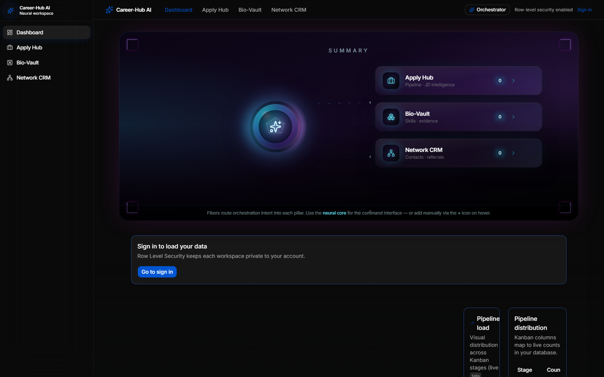

# Career-Hub AI

A command center for a job search: track applications, keep a reusable profile, manage your network, and prepare for interviews with an AI assistant on top of your own data.



## What it does

| Module | Purpose |
|---|---|
| **Apply Hub** | Application pipeline as Kanban stages, with job-description intelligence |
| **Bio-Vault** | Acquired skills with supporting evidence and a growth roadmap, with skill matching against job descriptions |
| **Network CRM** | Contacts and referrals, with AI-assisted profile parsing |
| **Interview Guide** | Generates interview answers from your own profile, with answer-length control and keyword highlights |
| **Orchestrator** | An AI assistant that plans and executes actions across the modules from a chat prompt |
| **Ops Watch** | Admin area with its own login and connection logs |

Each user's workspace is private to their account through Supabase Row Level Security.

## Tech stack

- **Framework:** Next.js 14 (App Router), React 18, TypeScript
- **UI:** Tailwind CSS, shadcn/ui, Radix UI, Framer Motion
- **Data and auth:** Supabase (Postgres, Row Level Security, SSR auth)
- **AI:** Google Gemini via `@google/generative-ai`, with a planner/executor orchestrator (`src/lib/ai`)

## Architecture notes

- `src/lib/ai` holds the orchestrator: a prompt and JSON schema for the plan, a normalizer that repairs model output, and an executor that runs the plan against the database.
- Model output is parsed defensively (`parse-model-json`) because LLMs return malformed JSON more often than expected.
- The database schema, patches and a dummy seed live in `supabase/`. `npm run db:provision` bundles and applies them.
- Server-only keys never reach the browser: only `NEXT_PUBLIC_*` variables are exposed.

## Getting started

```bash
git clone https://github.com/alisfand99/CareerHub.git
cd CareerHub
npm install
cp .env.example .env.local   # then fill in your own Supabase and Gemini keys
npm run dev                  # http://localhost:3005
```

Optional: `npm run db:provision` creates the tables in your Supabase project, and `supabase/seed_dummy.sql` loads sample data.

## Status

Working prototype built for personal use. Not yet deployed as a public service.
